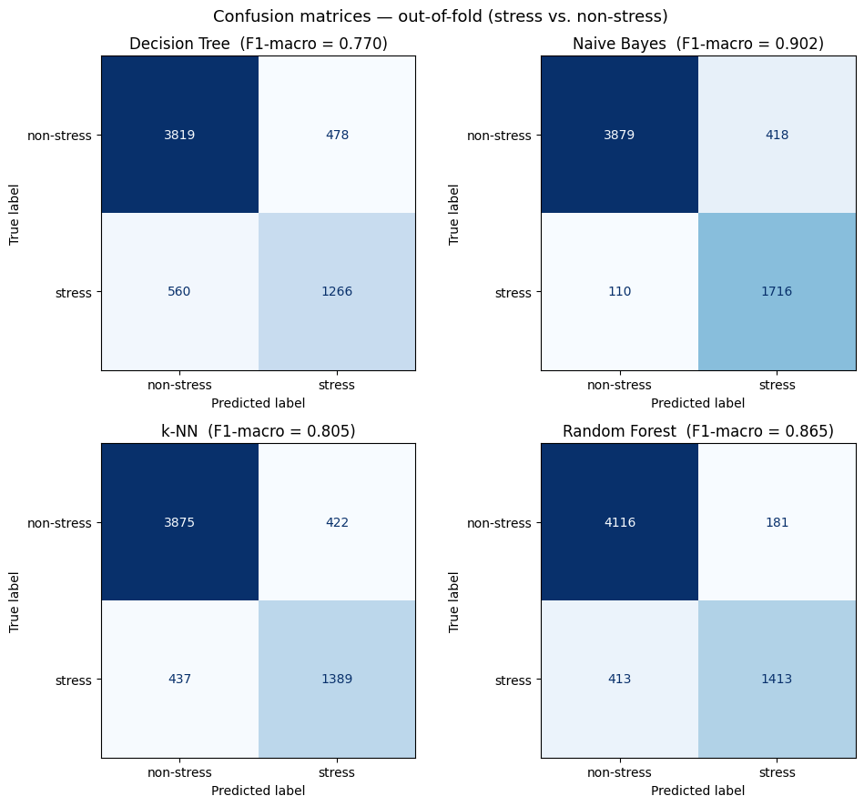
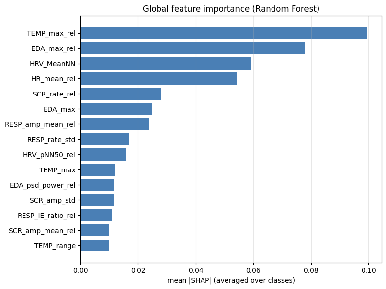
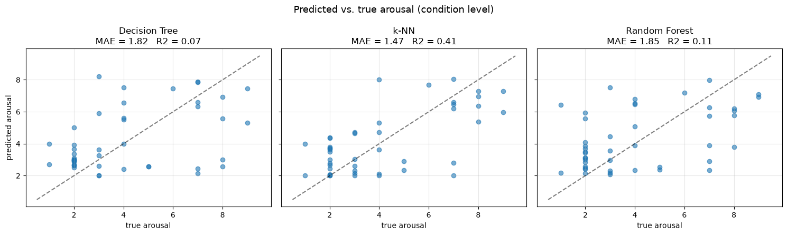

# Physiological Stress Detection on WESAD

Subject-independent stress classification and arousal regression from wearable physiological signals.

Course project for *Data Mining and Machine Learning* (University of Pisa, A.Y. 2025/26), by Elisa Consoni and Noemi La Gamba.

## Overview

This project builds a complete, leakage-safe machine-learning pipeline on the [WESAD](https://archive.ics.uci.edu/dataset/465/wesad+wearable+stress+and+affect+detection) dataset (15 subjects; chest RespiBAN and wrist Empatica E4 sensors; baseline, stress and amusement conditions). It addresses three tasks:

1. **Binary classification**: stress vs. non-stress.
2. **Three-class classification**: baseline vs. stress vs. amusement.
3. **Arousal regression**: predicting the self-reported SAM arousal score (1-9).

Everything is evaluated **subject-independently**: the model is always tested on a person it has never seen. The work replicates and extends Schmidt et al. (2018).

## Results

All figures are out-of-fold means over the 15 outer leave-one-subject-out folds (mean ± standard deviation across subjects), using chest features only.

| Task | Best model | Result |
|---|---|---|
| Stress vs. non-stress | Gaussian Naive Bayes | F1-macro **0.902 ± 0.090** (accuracy 0.913) |
| Baseline / stress / amusement | Gaussian Naive Bayes | F1-macro **0.765 ± 0.176** (accuracy 0.827) |
| Arousal regression | k-NN | condition-level R² **0.405**, MAE 1.47 on the 1-9 SAM scale |

| Model | Binary F1-macro | Three-class F1-macro |
|---|---|---|
| Decision Tree | 0.770 ± 0.150 | 0.617 ± 0.186 |
| Gaussian Naive Bayes | **0.902 ± 0.090** | **0.765 ± 0.176** |
| k-NN | 0.805 ± 0.212 | 0.656 ± 0.179 |
| Random Forest | 0.865 ± 0.130 | 0.716 ± 0.202 |

Main findings:

- **Amusement is the hard class.** Most three-class errors are amusement windows predicted as baseline. Participants rated the two conditions less than half a point apart on the SAM arousal scale, so the confusion reflects the data rather than the pipeline. SMOTE (applied inside the training folds only) changed F1-macro by at most 0.019, with no significant difference.
- **Wrist features add no robust gain.** Many wrist-derived cardiac features are frequently missing and are removed by the missingness filter; chest-only features perform comparably.
- **The models rely on physiologically meaningful features.** SHAP on the Random Forest highlights baseline-relative temperature, electrodermal and cardiac features (`TEMP_max_rel`, `EDA_max_rel`, `HRV_MeanNN`, `HR_mean_rel`).
- **Statistical caution.** With 15 subjects, the Friedman test on the binary task is significant (p = 0.0199) but no pairwise Wilcoxon comparison survives Holm correction, so differences between models should be read as indicative.

<p align="center">
  
  
</p>
<p align="center">
  
</p>

## Method

**Windowing and features.** Each recording is cut into overlapping 60-second windows with a 5-second stride (6,123 windows: 54.8% baseline, 29.8% stress, 15.4% amusement). From ECG, EDA, EMG, respiration and temperature, plus wrist BVP, EDA and temperature, the pipeline extracts 64 absolute descriptors (40 chest, 24 wrist): HRV (RMSSD, pNN50, LF/HF, Poincaré SD1/SD2, sample entropy), EDA tonic and SCR features, EMG activation, respiration rate and spectral features, and temperature statistics. Each feature is also expressed relative to the subject's own baseline (after Setz et al., 2010), giving 80 chest-only or 128 chest+wrist candidate features. Wrist acceleration is excluded because movement during the stress protocol could reveal the protocol rather than the physiological response.

**Leakage prevention.** Evaluation uses nested leave-one-subject-out (LOSO) cross-validation: one subject is held out in each outer fold, and hyperparameters are tuned with an inner LOSO search on the remaining subjects. All learned steps are fitted inside the training folds only:

1. `MissingnessFilter` drops features missing in more than 30% of training windows.
2. Median imputation and standard scaling.
3. `CorrelationFilter` removes redundant features (|r| > 0.9), keeping the more informative one.
4. Mutual-information selection of the top *k* features (a joint mRMR criterion is compared against this two-step filter).

The custom transformers live in [`feature_selectors.py`](feature_selectors.py).

**Models and statistics.** Decision Tree, Gaussian Naive Bayes, k-NN and Random Forest (plus regressors and a mean-predictor baseline for arousal), tuned by grid search on F1-macro (MAE for regression). Models are compared with a Friedman test followed by Holm-corrected Wilcoxon signed-rank tests on the 15 per-subject scores. Explainability uses TreeSHAP on a Random Forest trained on 11 subjects and explained on 4 unseen ones.

## Repository structure

```
.
├── Preprocessing_and_Feature_Selection/
│   ├── Chest/
│   │   ├── 00a_preprocessing_CHEST.ipynb        # windowing + feature extraction (chest)
│   │   └── 01a_feature_selection_CHEST.ipynb    # EDA, filter vs. mRMR selection
│   └── Combined/
│       ├── 00b_preprocessing_COMBINED.ipynb     # windowing + feature extraction (chest + wrist)
│       └── 01b_feature_selection_COMBINED.ipynb
├── 02_Classification.ipynb                      # binary and three-class pipelines, SMOTE, SHAP
├── 03_Regression.ipynb                          # arousal regression
├── feature_selectors.py                         # leakage-safe transformers
├── scripts/prepare_quest.py                     # collects SAM questionnaire files
├── figures/
└── requirements.txt
```

## Reproducing the results

Developed with Python 3.10.

1. **Install dependencies**
   ```bash
   pip install -r requirements.txt
   ```
2. **Download WESAD** from the [UCI repository](https://archive.ics.uci.edu/dataset/465/wesad+wearable+stress+and+affect+detection) (please check the dataset's terms of use there) and place the extracted `WESAD/` folder at the repository root, so that `WESAD/S2/S2.pkl` exists.
3. **Collect the questionnaires** (needed only for regression):
   ```bash
   python scripts/prepare_quest.py
   ```
4. **Extract features.** Open each notebook with its own folder as working directory and run, in order:
   - `Preprocessing_and_Feature_Selection/Chest/`: `00a_...` then `01a_...` (writes `chest_outputs/features.csv`)
   - `Preprocessing_and_Feature_Selection/Combined/`: `00b_...` then `01b_...` (writes `combined_outputs/features_all.csv`; the feature-extraction cell is slow)
5. **Run the models** from the repository root: `02_Classification.ipynb`, then `03_Regression.ipynb`.

Random seeds are fixed (`RANDOM_STATE = 0`).

## Limitations

- Only 15 subjects, so statistical power is limited and many model differences are not significant after correction.
- The arousal target is coarse: one self-report per subject and condition is shared by all windows of that segment, and the SAM scale is subjective.
- The SHAP analysis comes from a single subject-wise split and is qualitative, not an additional performance estimate.

## References

- Schmidt, P., Reiss, A., Duerichen, R., Marberger, C., Van Laerhoven, K. (2018). *Introducing WESAD, a Multimodal Dataset for Wearable Stress and Affect Detection.* ICMI, 400-408.
- Setz, C., Arnrich, B., Schumm, J., La Marca, R., Tröster, G., Ehlert, U. (2010). *Discriminating Stress From Cognitive Load Using a Wearable EDA Device.* IEEE Trans. Inf. Technol. Biomed., 14(2), 410-417.
- Koelstra, S., et al. (2012). *DEAP: A Database for Emotion Analysis Using Physiological Signals.* IEEE Trans. Affect. Comput., 3(1), 18-31.

## License

Code released under the [MIT License](LICENSE). The WESAD dataset is not included and is subject to its own terms.
